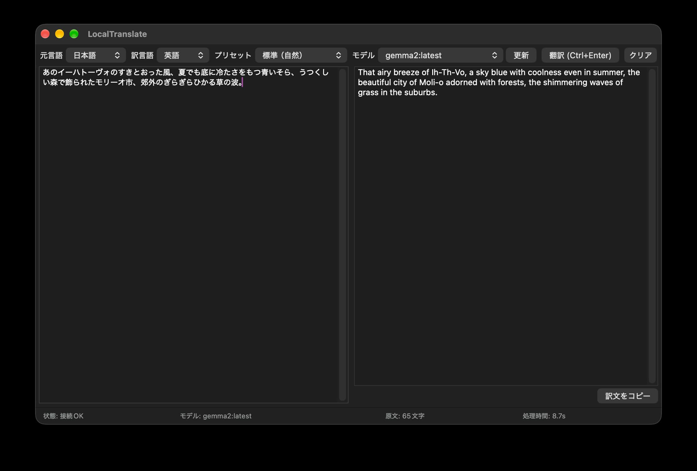
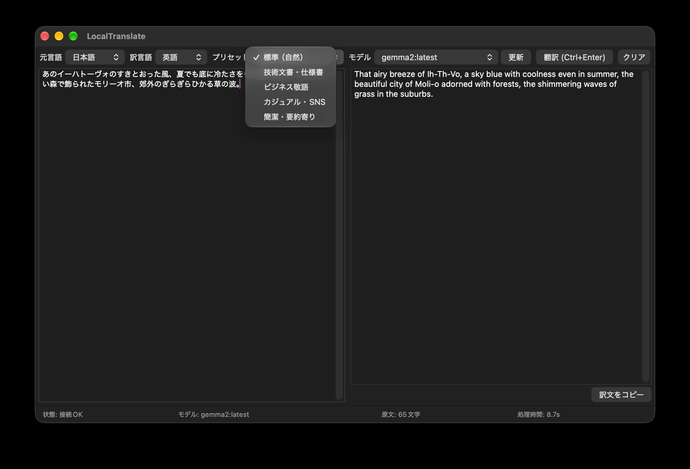

# LocalTranslate




Ollama をバックエンドにしたローカル翻訳クライアント（wxWidgets / C++17）。

## 特徴

- 外部サーバーやAPIキーを使わず、機密・未公開テキストでも安心して翻訳。
- OS標準の機械翻訳では難しい「トーン・文脈の指定」をプリセットで手軽に切り替えられます。

## 必要なもの

- CMake 3.16+、C++17 コンパイラ
- wxWidgets 3.1.5+（3.2 推奨）
  - Ubuntu: `sudo apt install libwxgtk3.2-dev`
  - macOS: `brew install wxwidgets`
  - Windows: vcpkg `vcpkg install wxwidgets` など
- Ollama（`ollama serve` 起動済み、モデル導入済み: 例 `ollama pull gemma3`）
- nlohmann/json と cpp-httplib は CMake が自動取得します（要ネットワーク）

## ビルド

```
    cmake -S . -B build -DCMAKE_BUILD_TYPE=Release
    cmake --build build -j
    ./build/LocalTranslate
```

## 使い方

1. 起動時にモデル一覧を自動取得（「更新」で再取得）
2. 左に原文を入力、言語・プリセット・モデルを選び「翻訳」または Ctrl+Enter
3. 「訳文をコピー」でクリップボードへ

エンドポイントは既定 `http://localhost:11434`。変更する場合は設定ファイル
（wxConfig: Linux `~/.LocalTranslate`、Windows レジストリ）の `endpoint` を編集します。
